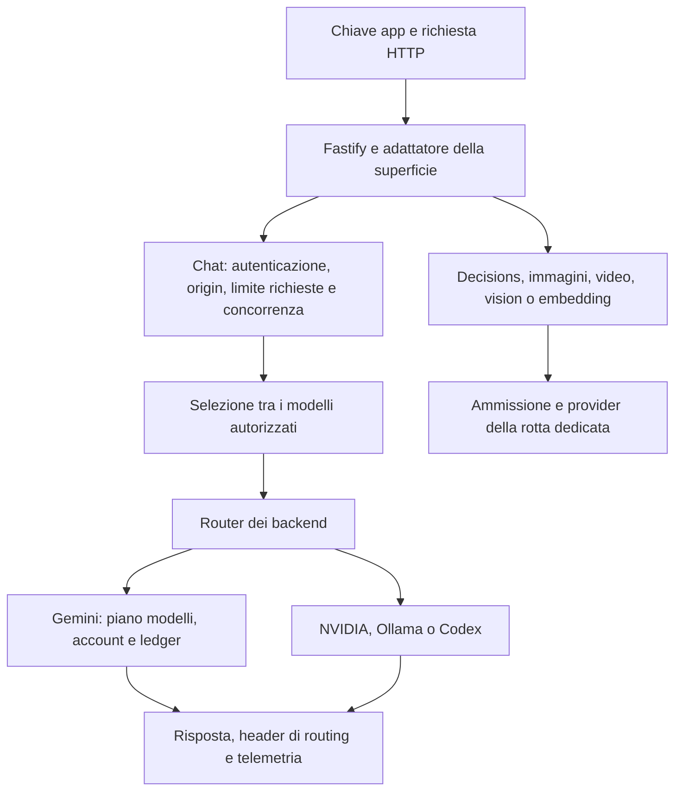

# GemRouter · Architettura e flusso di una richiesta

GemRouter è un processo Node.js che riceve richieste HTTP, applica la policy dell'app e sceglie il provider. Il processo conserva in memoria le code e parte della configurazione. File locali conservano app, account, contatori e cronologia tra i riavvii. Questa guida descrive il codice del prodotto. La configurazione e le autorizzazioni di ogni installazione possono essere diverse.

## Dal client alla risposta

Le quattro superfici configurabili sono `openai`, `gemrouter`, `deepseek` e `ollama`. GemRouter e DeepSeek condividono le rotte alla radice. La scelta della superficie determina il formato HTTP. La scelta del modello, le autorizzazioni e l'eventuale header `x-gemrouter-backend` determinano dove viene eseguita l'inferenza. Le rotte dedicate hanno controlli e formati propri. [API client](api.md)

## Avvio e proprietà della configurazione

1. Il processo carica l'ambiente e costruisce la configurazione dei provider in `src/config.ts`. Il percorso base predefinito è la directory di lavoro. Alcuni percorsi hanno impostazioni specifiche.
2. Se contiene un elenco utilizzabile, `data/model-config.json` sovrascrive l'ordine testuale definito nell'ambiente. L'editor **Routed Models** filtra gli ID rispetto alla tabella dei limiti effettiva. Esclude gli embedding e il modello dedicato alle decisioni.
3. Vengono creati i client dei provider, il router e gli store. La chiave bootstrap identifica l'app da riallineare alle impostazioni `GEMROUTER_BOOTSTRAP_*`. Durante l'allineamento, le app attive `all` ricevono l'universo dei modelli e le `custom` conservano l'intersezione con la propria lista. L'uso di Codex richiede anche il consenso esplicito dell'app.
4. Fastify inizializza gli eventuali servizi Codex e apre il listener. La discovery degli account ha una cache e un refresh periodico. Il processo accetta modifiche tramite le rotte amministrative che aggiornano lo stato in memoria e la relativa persistenza.

Un cambio di catalogo, un cambio di autorizzazione e una modifica al modello richiesto dal client hanno effetti diversi. Per esempio, concedere Hydrogen a un'app che invia esplicitamente `gemini-3.8-flash` le permette di richiedere Hydrogen. Le chiamate esistenti continuano a chiedere 3.8. [Configurazione](configuration.md) · [Avvio del servizio](../src/index.ts) · [Store delle app](../src/store/appStore.ts)

## Catalogo, account e ammissione Gemini

| Controllo | Domanda a cui risponde |
|---|---|
| Discovery globale | Quali modelli e metodi ha elencato Google per la chiave usata dalla discovery? |
| Configurazione del router e policy dell'app | Quali ID e quali operazioni sono disponibili a questa app? |
| Whitelist e catalogo del singolo account | Quali modelli può tentare questa chiave? |
| Ledger per gruppo di quota e modello | Il router può riservare una richiesta e i token stimati in questo momento? |
| Risposta di inferenza | Il progetto ha effettivamente servito questa operazione? Quale versione ha risposto? |

La chiave può provenire da un record avanzato, dall'inventario degli account o da una lista di chiavi. Quando si usa quest'ultima insieme a metadati separati, l'abbinamento è per posizione. Assegnare lo stesso `quotaGroup` alle chiavi che consumano la quota dello stesso progetto Google. [Configurazione degli account](configuration.md) · [Quote Google](https://aistudio.google.com/docs/rate-limits)

La discovery per account conserva l'ultimo elenco completo ottenuto con successo, anche quando è vuoto o un refresh successivo fallisce. Una chiave senza uno storico utilizzabile si basa sulla whitelist configurata. Un rifiuto definitivo per modello inesistente o quota pari a zero può bloccare la singola coppia account/modello. Le chiamate di prova amministrative distinguono un modello presente nel catalogo da uno che ha restituito un risultato. [Catalogo per account](../src/llm/providers/gemini-api/accountCatalog.ts) · [Censimento e prove](gemini-account-census.md)

## Esecuzione della chat

Il parser associa una richiesta senza `model` al primo ID testuale incorporato, attualmente `gemini-4-hydrogen`. Se l'ID è configurato e l'app è autorizzata, il router lo mantiene. In caso di ripiego per policy, il router sceglie il primo modello abilitato per l'app nella lista di fallback. Cambiare l'ordine nella dashboard può quindi avere effetti diversi su questi due percorsi. Per una selezione esplicita, impostare `model` nel client. [Parser OpenAI](../src/lib/openai.ts) · [Policy HTTP](../src/index.ts)

Lo scheduler Gemini tenta il modello richiesto e ordina gli altri candidati autorizzati in base alla loro capacità relativa, alla famiglia e all'ordine configurato. Con entrambi disponibili, il primo ripiego di Hydrogen è 3.8 Flash. Per Hydrogen, la catena Gemini precede il ripiego sequenziale su NVIDIA delle app abilitate. Per altre richieste Gemini idonee può partire una chiamata NVIDIA in parallelo. Un backend esplicito limita il passaggio tra provider. [Router](../src/llm/router.ts) · [Piano dei modelli](../src/llm/providers/gemini-api/client.ts)

Lo scheduler Gemini usa un budget di sei tentativi upstream per richiesta di chat. Per alcuni errori del modello richiesto può tentare fino a tre chiavi. Un candidato di ripiego ha un budget di una chiave. La scelta considera priorità dell'account, capacità disponibile e uso recente. Con candidati successivi, Hydrogen può usare fino a metà del tempo residuo, con un massimo di 45 secondi e nel rispetto del timeout del provider. Un errore di disponibilità già ricevuto consente di passare subito al candidato successivo. [Scheduler Gemini](../src/llm/providers/gemini-api/client.ts) · [Selezione delle chiavi](../src/llm/providers/gemini-api/keyPool.ts)

Il builder converte le opzioni per il modello che sta per ricevere la richiesta. Per Hydrogen promuove `minimal` a `low` e supporta `xhigh`. Per Flash 3.7 e 3.8 usa `low`–`high`. Omette la temperatura su queste tre famiglie e `thinkingConfig` su Gemma. Gemini chat restituisce testo bufferizzato anche quando la superficie HTTP usa SSE. [Adattatore Gemini](../src/llm/providers/gemini-api/client.ts)

## Decisioni e altri flussi dedicati

`POST /v1beta/decisions` autentica l'app, acquisisce uno slot, verifica il grant `gemini-decision-1` e invia una richiesta alla Decisions API di Google. Condivide account e ledger con Gemini chat. Il modello ha un proprio contatore e usa domande tipizzate e risposte in `answers`. La discovery verifica il metodo `createDecision`. [Contratto Decisions](api.md) · [Validazione](../src/llm/providers/gemini-api/decisions.ts)

Vision ed embedding dedicati sono gestiti dal provider Ollama locale, mentre il provider Agnes espone immagini e video. Autorizzazioni, coda e tracciamento delle rotte dedicate variano per rotta. Per scegliere un endpoint per dati multimodali, verificare sia i tipi di input sia i controlli applicati. [Riferimento per rotta](api.md)

## Quota, contabilità e persistenza

Quando una richiesta viene ammessa, il ledger prenota RPM, TPM di input stimati e RPD sul gruppo/modello. Registra l'invio prima della chiamata al provider e, quando disponibili, riconcilia i token di input con quelli misurati. Un timeout dopo l'invio può restare contabilizzato. I 429 e i 503 riconosciuti come sovraccarico seguono politiche specifiche di conteggio e attesa. Il giorno RPD segue la mezzanotte in `America/Los_Angeles`. [Ledger](../src/llm/providers/gemini-api/quotaLedger.ts) · [Routing e quota](routing.md)

Il volume token mostrato ai client e in dashboard segue un percorso diverso dal ledger di ammissione. Per chat e Responses i provider diversi da Codex usano una stima del testo. Codex può fornire uso misurato oppure segnalare un dato indisponibile. Decisions usa i conteggi della risposta nativa. Gli aggregati possono pertanto includere misure e stime. [Calcolo dell'uso](../src/lib/openai.ts) · [Aggregazione](../src/store/interactions.ts)

| Stato | Proprietario e uso |
|---|---|
| Ambiente e registro account | Credenziali, abilitazioni e gruppi quota. Il registro può contenere chiavi in chiaro. |
| `apps.json`, `model-config.json`, `compatibility.json` | App, hash delle chiavi client, modello di accesso, ordine testuale e superfici. |
| Cache discovery e ledger | Le cache conservano i cataloghi. Il ledger conserva anche prenotazioni, finestre quota ed esiti. |
| `interactions.json` e `audit.log` | Interazioni recenti, estratti di prompt/risposta quando registrati, aggregati orari ed eventi operativi. |
| Directory privata Codex | Login e stato del provider, con gestione del ripristino separata dall'export del router. |

La configurazione del servizio, il backup e il ripristino hanno procedure diverse. Il ripristino va verificato su una directory isolata prima di usarlo su un'installazione attiva. [Operazioni e ripristino](operations.md) · [Provider Codex](codex-account.md)

## Estendere la catena dei modelli

1. Verificare ID e metodo upstream, scegliere la rotta e provare un input sintetico con una chiave del progetto interessato. Per un modello di testo, controllare anche i parametri di generazione.
2. Aggiornare limiti, cataloghi e selezione del provider. Aggiornare l'ordine persistito e le whitelist di account e app che devono avere accesso. Dare ai modelli con un contratto diverso una rotta e controlli appropriati.
3. Verificare modello richiesto e servito, ripiego su indisponibilità, comportamento di un'app esclusa e ripristino della policy dopo il riavvio. Le fixture HTTP coprono Hydrogen e Decisions con upstream simulati. [Test di contratto](../tests/gemini-models-http.test.ts) · [Test dello scheduler](../tests/gemini-scheduler.regression.test.ts)
